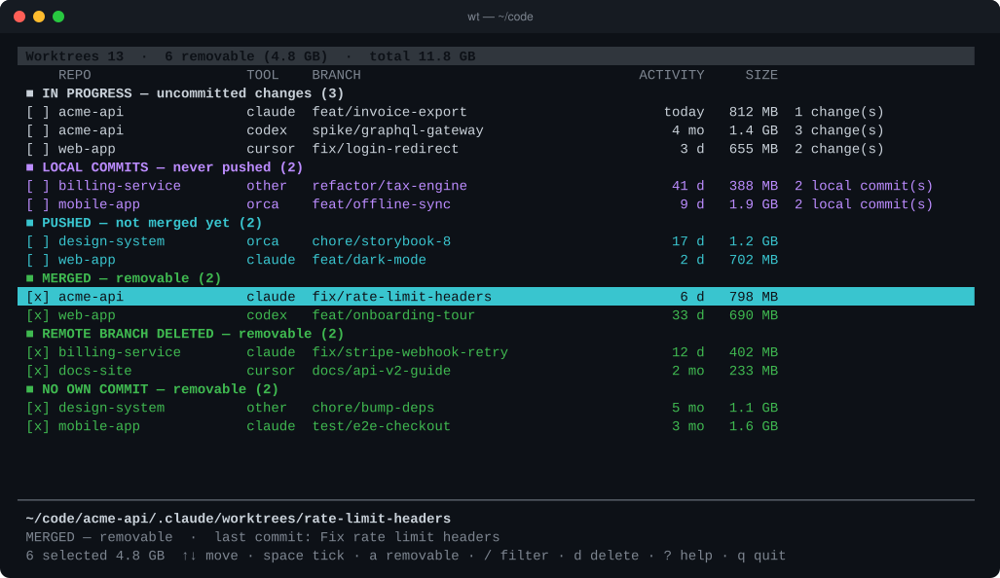

# wt-status

**See every git worktree on your machine, and clean them up without losing work.**

AI coding agents (Claude Code, Codex, Cursor, Orca…) love worktrees: one per task, each with its
own `node_modules`. A few weeks later you have dozens of them across `~/.claude`, `~/.codex`,
`~/.cursor` and your repos. Some still hold work, most don't, and nobody remembers which.
Meanwhile they quietly eat tens of gigabytes.

`wt` finds them all, tells you which ones can go, and removes them safely.



## Install

```sh
curl -fsSL https://raw.githubusercontent.com/RomualdP/wt-status/main/install.sh | sh
```

This installs one Python file, `wt-status`, plus a `wt` alias, into `~/.local/bin`. To pick
another folder, set `WT_INSTALL_DIR`. You can also clone the repo and run `./install.sh`.

It needs **Python ≥ 3.9** and **git ≥ 2.17**, and nothing else (no pip packages).
It runs on macOS and Linux. The plain report works on Windows too.

## Usage

```sh
wt                       # interactive: browse, tick, delete
wt-status                # plain report, grouped by state
wt-status --size         # ... with disk size and space you can free
wt-status --repo api     # only repos whose name contains "api"
wt-status --clean        # remove every removable worktree, after confirmation
```

### States

| State | Meaning | Removable? |
|---|---|---|
| In progress | uncommitted changes | no (force with `D`, changes are stashed) |
| Local commits | commits that were never pushed | no (force with `D`, branch is kept) |
| Pushed | on the remote but not merged, probably an open PR | no |
| Merged | `HEAD` is already in `main` / `master` / `develop` | **yes** |
| Remote branch deleted | upstream is gone, usually after a squash-merged PR | **yes** |
| No own commit | created but never committed to | **yes** |
| Orphan | folder already deleted, only git metadata is left | **yes** (prune) |
| Unknown | `git status` failed, so the tool refuses to guess | no |

### Keys (`wt`)

| Key | Action |
|---|---|
| `↑` `↓` / `j` `k`, `PgUp` `PgDn`, `g` `G` | move |
| `space` | tick / untick |
| `a` | tick every removable worktree |
| `v` | tick worktrees idle for more than 60 days |
| `n` | untick everything |
| `/` | filter by repo, branch or tool (`claude`, `codex`, `cursor`, `orca`) |
| `d` | remove the ticked worktrees, or the current one (never forced) |
| `D` | **force**-remove, even with changes (type `yes` to confirm) |
| `c` | remove empty Codex placeholder folders |
| `o` | open in the file manager |
| `r` | rescan |
| `?` | help |
| `q` | quit |

## Safety

- **Branches are never deleted.** Removing a worktree only removes its folder. Every commit stays reachable.
- **`d` and `--clean` never force.** They call `git worktree remove` without `--force`, so git refuses to remove anything with uncommitted or untracked files.
- **`D` keeps everything it can:**
  - uncommitted and untracked changes go into `git stash` first (list them with `git stash list`, restore one with `git stash apply`);
  - commits made on a detached `HEAD` are kept on a new `wt-backup/<name>` branch;
  - if either step fails, nothing is removed.
- **No guessing.** If git cannot tell the state of a worktree, it is shown as *Unknown* and is never pre-selected.
- **Read-only by default.** Scanning runs git with `--no-optional-locks`, so it never rewrites your index, and the tool sends no data anywhere.

## Configuration

| Variable | Default | |
|---|---|---|
| `WT_ROOTS` | `~/code:~/dev:~/src:~/projects:~/repos:~/git:~/work:~/workspace:~/Developer:~/Documents:~/orca/projects` | folders scanned for main repositories (separated by `:`) |
| `WT_LANG` | from `$LANG` | `en` or `fr` |
| `NO_COLOR` | unset | disables colours in the plain report |

Worktrees are found **through their main repository**: a worktree in `~/.codex/worktrees` shows up
as long as the repo it belongs to is under one of `WT_ROOTS`. Normal repos and bare-repo layouts
(`project/.bare` + sibling worktrees) are supported.

## Development

```sh
python3 -m unittest discover -s tests -v
```

The tests create throw-away repositories in a temporary folder. The screenshot uses fictional
repositories.

---

🇫🇷 L'interface est aussi disponible en français : elle s'affiche automatiquement si `LANG` commence par `fr`, ou avec `WT_LANG=fr`.

## License

[MIT](LICENSE)
